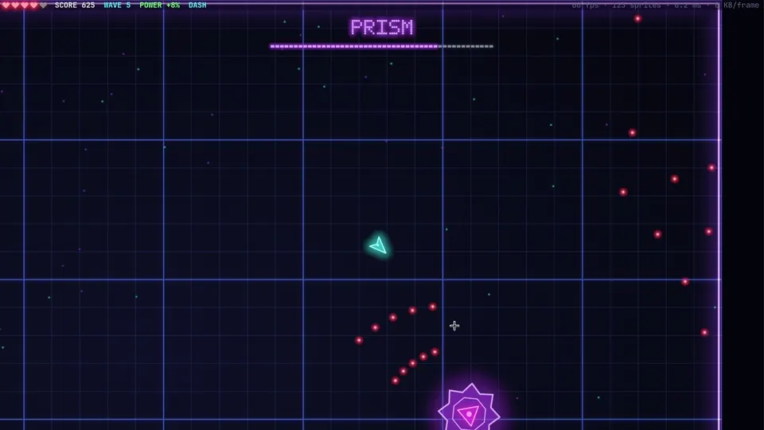

# Catnip



A small Rust game engine for the [kitty](https://sw.kovidgoyal.net/kitty/) terminal.
It also runs in [Ghostty](https://ghostty.org), which implements kitty's protocols.

Catnip doesn't draw with text characters. It uploads sprite sheets to kitty once
and then moves them around as image placements every frame, so kitty's GPU does
the compositing. A busy frame is a few kilobytes of escape codes and well under
a millisecond of CPU time.

It targets kitty's protocols on purpose, instead of the lowest common
denominator that works in every terminal.

## Glowstorm

A twin-stick arena shooter, and the first game built on Catnip.

### Install

Glowstorm needs [kitty](https://sw.kovidgoyal.net/kitty/) or
[Ghostty](https://ghostty.org) to play in. Started from any other terminal, it
opens itself in one of them.

- **Download:** grab `glowstorm-v*-x86_64-linux.tar.gz` from
  [Releases](https://github.com/Hemantabhusal/catnip/releases), unpack it and
  run `./glowstorm`.
- **Build from source** (needs [Rust](https://rustup.rs); on Linux, also the ALSA
  headers, `libasound2-dev` on Debian/Ubuntu):

  ```sh
  git clone https://github.com/Hemantabhusal/catnip
  cd catnip
  cargo run --release
  ```

Sound uses CoreAudio on macOS and ALSA on Linux (`alsa-lib` on Arch,
`libasound2` on Debian/Ubuntu); without an audio device the game runs silently.
Use `glowstorm --no-sound` (or `cargo run --release -- --no-sound`) to skip sound
synthesis, audio initialization, and playback when comparing frame rates.
`glowstorm -h` or `glowstorm --help` shows the available options.

The frame rate defaults to **60 FPS**; use `--fps 144` to change the target.
Start with spread shot and permanent rapid fire (the lightning-bolt pickup) with:

```sh
glowstorm --spread-shot --rapid-fire --fps 144
```

`--lightning` is an alias for `--rapid-fire`. Every game setting also accepts an
environment variable; command-line flags take precedence:

| Flag | Environment variable | Default |
|---|---|---|
| `--no-sound` | `GLOWSTORM_NO_SOUND` | off |
| `--fps <FPS>` | `GLOWSTORM_FPS` | 60 (valid range: 1–65535) |
| `--scale <SCALE>` | `GLOWSTORM_SCALE` | automatic (override: 0.3–1.8) |
| `--wave <WAVE>` | `GLOWSTORM_WAVE` | 1 |
| `--god` | `GLOWSTORM_GOD` | off |
| `--cards` | `GLOWSTORM_CARDS` | off |
| `--perfect-cooling` | `GLOWSTORM_PERFECT_COOLING` | off |
| `--spread-shot` | `GLOWSTORM_SPREAD_SHOT` | off |
| `--rapid-fire` / `--lightning` | `GLOWSTORM_RAPID_FIRE` | off |

Boolean environment values accept `1`/`0`, `true`/`false`, `yes`/`no`, or `on`/`off`.
Invalid values produce a usage error. The requested FPS is a target; terminal
rendering speed may limit the achieved rate.
The render scale is capped at 1.8 to keep the expanded sprite atlas and base arena
within kitty's image budget.

| Control | Action |
|---|---|
| WASD | move |
| Shift + WASD | heat-powered thrust: stronger forward, weaker reverse |
| mouse | aim |
| mouse wheel down / up | next / previous weapon, wrapping through 1–9, 0 |
| hold left click | fire |
| 1 / 2 / 3 / 4 | default gun / sniper / rocket blaster / plasma gun |
| 5 / 6 / 7 | gravity gun / ricochet gun / chain lightning |
| 8 / 9 / 0 | returning blade / sticky mines / flamethrower |
| hold middle click / E, then release | charge and release the selected weapon |
| tap right click / Space / R | barrel roll |
| hold right click / Space / R, then release | charge a star-laser spin |
| Esc / P | pause |
| Q | quit |

The selected weapon's number and name appear in a highlighted row beneath the
score. Use the wheel or number keys to switch while moving and firing. Switching
cancels a pending weapon charge; heat and firing cooldown carry over.

Enemies come in waves, and every attack starts with a visible wind-up:
chasers lunge, swarms flank, shooters lead their shots, and tanks slam out a
shockwave when you get close. Six more enemies join the roster as the run advances:

| Enemy | First wave (Medium) | What to watch for |
|---|---|---|
| Skirmisher | 6 | Circles and strafes while firing narrow fans. |
| Sniper | 7 | Locks a firing line during a long wind-up, then fires fast rounds. |
| Spinner | 8 | Sends rotating radial volleys through the arena. |
| Bomber | 9 | Lobs staggered rings of slow, heavy bullets while other enemies close in. |
| Splitter | 11 | Rushes into the fight and breaks into a swarm on death. |
| Sentinel | 12 | Alternates crossfire with aimed barrages. |

Each ordinary wave uses at most three enemy types, including enemies created on
death. Opening waves introduce new types in focused combinations; groups take
turns spawning so the whole combination appears. From wave 12 on Medium, these
six combinations repeat, skipping boss waves:

| Enemies | Play style |
|---|---|
| Sentinel + Sniper | Dodge barrages while keeping clear of locked firing lines. |
| Bomber + Spinner + Skirmisher | Weave through slow fields and radial fire while being flanked. |
| Splitter + Swarm + Shooter | Manage rushing packs while dodging ranged support. |
| Tank + Chaser + Sniper | Make space around heavy enemies without retreating into sniper fire. |
| Sentinel + Skirmisher + Swarm | Keep moving through crossfire and encircling enemies. |
| Chaser + Shooter + Spinner | Alternate between evading lunges and threading bullet gaps. |

Every fifth wave brings a boss. All five have three health phases, visible
attack warnings, and recovery windows; later phases add denser bullet patterns.

| Boss | First appearance | Attack style |
|---|---|---|
| PRISM | Wave 5 | Rings, aimed fans, spirals, charges, and summoned minions. |
| HELIX | Wave 10 | Counter-rotating spiral arms weave crossing paths. |
| LOTUS | Wave 15 | Flower-shaped barrages leave gaps between the petals. |
| LOOM | Wave 20 | Sweeping curtains carry moving gaps between their rows of bullets. |
| ECLIPSE | Wave 25 | Rotating crosses interleave with aimed fire and ring pressure. |

The boss cycle repeats from wave 30. Shoot through incoming bullets to open a
path, follow the gaps, and use the warnings to reposition before each barrage.
To practice a specific encounter, start with `glowstorm --wave 10` (HELIX),
`--wave 15` (LOTUS), `--wave 20` (LOOM), or `--wave 25` (ECLIPSE).

From wave 6, rare elite enemies show up with a gold ring: three times the
health, a nastier attack, and guaranteed loot. After each boss you pick one of
three upgrades: spread shot, piercing bullets, twin dash, coolant, a shield orb,
an extra heart, or longer range.

Pick Medium, Hard or Extreme on the title screen. Harder settings mean fewer
hearts and faster, more aggressive, more numerous enemies, and pay up to 2× the
score.
Enemies grow stronger every wave; you grow a little too, roughly 1.2× by the
time they're twice as tough.

The left-click weapon starts as **1 GUN**. Press **2** for the sniper: accurate,
elongated shots travel four times faster, fire every half second, and start with
eighteen times the damage. Rounds pierce ships, including the boss, losing 35% of their
remaining damage with each hit. Piercing upgrades reduce that loss by 10 percentage
points per level; Spread, Long Range, Coolant, and Rapid still apply.
Sniper rounds also destroy enemy bullets without being consumed. Each interception
randomly deflects the round by up to 30 degrees, preserving its speed and damage.
Hits shove surviving ships into a lingering drift. Entry impacts throw small sparks
backward; exits eject a larger, brighter spray of debris forward along the round's path.
All main weapons share heat and firing cooldown. Press **1** to switch back.
With the sniper selected, middle mouse / E charges a rapid stream of sniper rounds
instead of a spread barrage. It follows your aim without scatter, pierces ships,
and deflects off enemy bullets. More charge increases damage, reach, and duration;
Spread upgrades increase its firing rate while keeping the stream straight.
Heavy projectile hits stun enemies: they stop attacking, slow to a drift, and
tumble with yellow sparks before recovering. A full sniper hit stuns for about
1.2 seconds; weakened piercing rounds cause shorter stuns. Even weak sniper hits
briefly stagger enemies. Bosses resist other weaker hits and only stagger briefly,
pausing their attacks.
Repeated heavy hits refresh the stun rather than adding durations together.

Press **3** for the rocket blaster: slow rockets explode on ships, enemy bullets,
walls, or at the end of their range. A blast reaches 200 units, deals splash damage,
clears enemy bullets, and pushes ships outward. Enemies caught in it are stunned
for 2–3 seconds; bosses stagger for up to a second. Middle mouse / E charges a
fan of 1–10 rockets, with more charge launching more rockets with stronger blasts.
Charged rockets turn gently toward enemies ahead of them. The usual release bonus,
overheat penalty, Coolant, and Long Range apply; normal fire also uses Spread and Rapid.
Your ship loses a heart only when its center is strictly inside the inner half
of the blast radius, with normal hit grace and evasion protection. The outer half
pushes you without damage. Orange sparks outline the blast, with a smaller yellow
ring marking the dangerous inner half.

Press **4** for the plasma gun: a torrent of blue-white plasma bolts with heavy
damage and knockback. Impacts splatter hot plasma across the target.
Middle mouse / E charges the **BFG**, gathering an increasingly large ball of
green plasma at the muzzle. Release sends it through the arena, annihilating
ordinary enemies in its path and heavily damaging bosses. It consumes enemy
bullets and keeps flying until it hits a wall or reaches its range. Press middle
mouse again to detonate all flying BFG balls immediately. Each ball erupts
in a wide green blast that damages and throws back nearby enemies. The blast
lights up each target with green plasma, without hurting your ship. More charge
means a bigger ball and blast; the usual heat timing bonus and overheat penalty apply.

The remaining number keys offer six more weapons. All use left click for normal
fire and middle mouse / E for charging, with the same shared heat, release bonus,
overheat penalty, and perfect-cooling support:

- **5 GRAVITY:** a violet field gathers nearby ships and hostile bullets, then
  hurls them forward. Thrown ships smash into other enemies; captured bullets
  become friendly ammunition. Charging gathers a wider cluster for a stronger throw.
- **6 RICOCHET:** gold rounds bank off walls, gaining 30% damage with each bounce.
  Charging makes a larger, stronger round with more bounces. Each new bank lets
  it hit the same ship again.
- **7 LIGHTNING:** arcs jump through nearby enemies with decreasing damage.
  Charging releases a sustained storm that branches through connected groups,
  stunning enemies and clearing bullets along the arcs. Keep aiming during the storm.
- **8 BLADE:** a spinning saw cuts through enemies and returns to your current
  position. Move to steer its return path through more targets; it can hit each
  ship once going out and once coming back. Charging makes it larger, slower,
  and more powerful.
- **9 MINES:** explosives stick to ships and arena walls. Charging sets your
  planted mines off in sequence, with stronger and wider blasts at higher charge.
  If none are planted, it launches a cluster with timed fuses instead.
- **0 FLAME:** a short cone coats ships in burning fuel. Charging throws a fuel
  glob that ignites nearby enemies and leaves a burning patch on the floor.
  More charge gives a larger blast and a longer-lasting fire.

These six weapons do not damage the player. Mines and other lingering effects
have finite lifetimes and limits, including with perfect cooling enabled.

Hold Shift while moving along your aim direction to engage the rear rocket,
giving about twice the forward speed. Moving backward engages two smaller front
thrusters for a weaker but noticeable boost. Thrust adds to gun heat, leaving less
room for firing or charging; overheating disables the extra thrust until you cool.
Sideways movement keeps its usual speed, and Coolant reduces thrust heat too.
Keep aiming and firing with the mouse while holding Shift. Ghostty receives
Shift-modified mouse input during the game; its `mouse-shift-capture = never`
setting prevents this, so use the default `false` if you want to thrust and fire.
Automatically opened kitty windows disable terminal mouse bindings for the game.
When starting directly in kitty, use `kitty -o clear_all_mouse_actions=yes glowstorm`
to open a game window where Shift-click reaches the ship instead of selecting text.

Hold middle mouse or E to charge the gatling gun (about 0.6 seconds from cold),
then release a rapid spread barrage. Keep aiming as it fires. Longer charges
increase pellet damage, reach, and burst duration (up to 1.6 seconds); the barrage
starts strong and weakens as it runs out. Each volley sprays six pellets;
Spread upgrades add four more per level, and
Piercing and Long Range apply too.
Release in the final 10% of the heat meter, when **RELEASE!** appears, for 10%
extra damage, faster pellets, and a faster firing rate. Holding too long forces
it to fire with 25% less damage and overheats the gun; release before charging
again. All weapons share heat. Regular fire and charging wait until the barrage
finishes; Coolant extends the charging time.
Every bullet pushes its target along its flight direction, including bosses.
Repeated impacts build momentum, while firing gives your ship a little recoil.
Direct hits destroy enemy bullets, including tank volleys and boss shots.
Normal, gatling, and plasma shots are consumed too; sniper rounds keep flying with a deflection.

Right click, Space or R starts an immediate forward barrel roll, spending a dash
charge. Release within 0.18 seconds for evasion; keep holding to charge the
offensive version, then release to fire a rotating eight-spoke star laser.
Holding can charge it even while evasion is recharging.
It shares the gatling's heat rules: more charge means more damage and
duration (up to 1.6 seconds); release in the final 10% of heat for 10% extra
damage and a faster spin. Overheating forces a discharge with 25% less power
and requires release to rearm. Coolant extends charging time. The white-hot lasers
extend to the arena walls, throwing sparks and leaving a fading orange heat glow
along their path and at the wall. They become thinner as their power fades.
They rotate at half a turn per second (0.8 with the timing bonus) and
destroy enemy bullets they touch;
the close shield reflects bullets back as friendly shots. Ship contact deals
heavy damage and pushes enemies away. You keep normal movement control throughout
the laser spin and can take damage with normal knockback and hit grace; hits do
not cancel the laser.
Landing inside enemy ships destroys all overlapping ships (including the boss)
and costs one heart, even during hit grace.

Your gun heats up as you fire and locks for a second if it overheats, and
shots lose up to a quarter of their damage at long range, so it pays to get
close. Quick kills build a multiplier up to ×8 with a rising note for every
kill in the chain; getting hit resets it. Best scores are kept per difficulty in `~/.local/share/glowstorm/`.

The arena is at least 2400 × 1500 game units. Larger terminals expand its width
and height independently to fill the window, including when resized mid-run.

## How it works

- All art is generated in code at start-up, at the window's real pixel size:
  one sprite atlas (rotations are pre-rendered, since kitty can't rotate an
  image) and one large arena floor.
- Both are sent to kitty through shared memory. Frames contain placement commands;
  the floor is rebuilt and uploaded again when resizing changes the arena size.
- The camera scrolls by changing which part of the floor image is shown.
- Input uses kitty's keyboard protocol (so held keys and key release work) and
  pixel-precise mouse reporting.
- Titles are neon sprite text drawn from a built-in 5×7 pixel font, frames use
  synchronized output, and sound effects are synthesized at start-up.

The repository is a Cargo workspace with two crates:

```
crates/
├── catnip/              the engine (crate catnip-engine), no game-specific code
│   ├── src/kitty.rs     graphics protocol: uploads, placements
│   ├── src/term.rs      terminal setup, window size, input modes
│   ├── src/gfx.rs       procedural shapes, glow, atlas packing
│   ├── src/font.rs      5×7 pixel font
│   ├── src/synth.rs     sound synthesis and playback
│   └── examples/spike.rs  placement and bandwidth benchmark
└── glowstorm/           the game
    ├── src/main.rs      start-up and terminal detection
    ├── src/app.rs       frame loop and input events
    ├── src/sound.rs     the game's sound effects
    ├── src/art/         sprites, palette, fonts, arena floor
    ├── src/game/        simulation: player, enemies, waves, combat, boss, upgrades
    └── src/render/      drawing: the arena, HUD and menus
```

## Requirements

- a recent kitty, or Ghostty 1.x
- Linux or macOS
- CoreAudio on macOS, ALSA on Linux; the game runs silently without an audio device

## Known issues

- **Ghostty on Linux:** pressing right-click while holding left-click makes
  Ghostty lose the left-button release, so the gun keeps firing until your next
  left click. Dash with Space instead. kitty isn't affected.

## Resource use

Measured on a laptop (i5-13500H, Intel Iris Xe) with a maximized kitty window:

| | CPU (one core) | Memory |
|---|---|---|
| Glowstorm | about 3% | about 17 MB |
| kitty while playing | about 15% | about 120 MB |

A frame takes about 0.2 ms of CPU and 2–10 KB of escape codes. Integrated
graphics is enough. Start-up takes a second or two while the art is drawn.

## Benchmark

```sh
cargo run --release -p catnip-engine --example spike
```

Moves bouncing sprites around with an on-screen readout of fps and bytes per
frame. `]` and `[` double and halve the sprite count, `b` toggles a full-window
pixel buffer, `u` removes the 60 fps cap. On a recent laptop, kitty keeps about
1,500 moving sprites at 60 fps.

## Development

```sh
cargo test --workspace
cargo clippy --workspace --all-targets
```

`--wave 6` starts at wave 6, `--god` prevents death but keeps hit reactions, and
`--cards` opens the upgrade screen right away. `--scale 0.8` forces a render scale.
`--perfect-cooling` removes all gun, charge, and thrust heat, allowing
continuous fire and boost. Charged weapons still fill normally, then hold full
charge until released, without an overheat penalty or heat timing bonus.
Runs that skip waves or enable god mode, cards, perfect cooling, spread shot, or
permanent rapid fire don't save a best score. Logs go to `$TMPDIR/glowstorm.log`.
The internal `GLOWSTORM_RELAUNCHED=1` setting (also accepted as the hidden
`--relaunched` flag) prevents repeated attempts to open a supported terminal.

## License

MIT, see [LICENSE](LICENSE).
